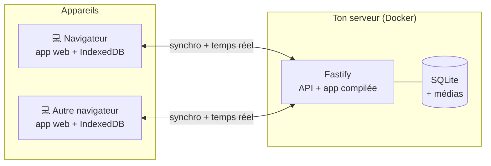

<div align="center">

[English](README.md) · Français


# Halko

**Suivi d'entraînement auto-hébergé : planifie tes séances, suis-les en direct, vois ta progression.**

[](LICENSE)


[](https://github.com/ZSR17/halko/actions/workflows/ci.yml)
[](https://github.com/ZSR17/halko/releases)
[](https://github.com/ZSR17/halko/pkgs/container/halko)

</div>

Halko est une application web pour planifier ses séances, les suivre en direct et voir sa progression.
Elle tourne sur ton propre serveur (un petit ordinateur suffit) et garde une copie des données dans le
navigateur : une coupure de réseau n'interrompt rien, la synchronisation reprend au retour. Des apps
iPhone et Android natives sont prévues ; elles utiliseront la même API de synchronisation.

Pas de compte, pas de publicité, pas de service tiers : tes données restent chez toi.

## Fonctionnalités

**Bibliothèque**
- 876 exercices en français et en anglais, avec images, consignes et muscles travaillés sur une silhouette anatomique.
- Muscles principaux et secondaires choisis sur la silhouette (les exercices qui les travaillent ainsi, la liste se
  resserrant à chaque muscle ajouté), filtres par groupe musculaire et par matériel disponible ou sans matériel, et recherche par nom (dans la langue choisie ou en anglais).
- Tes propres exercices, avec photo, vidéo ou GIF (convertis automatiquement pour rester légers), envoyés
  depuis un fichier ou importés depuis un lien Internet et gardés sur ton serveur.
- Ta version d'un exercice de la bibliothèque (nom, muscles, médias), rétablissable à tout moment.

**Séances**
- Créateur de séances : exercices réordonnés par glisser-déposer, supersets.
- Des dossiers pour ranger ses séances, si on veut : glisser une séance sur un dossier ; dossiers et
  séances se rangent ensemble.
- Huit types d'exercice : poids et répétitions, durée (gainage), distance et durée, etc.
- Séries d'échauffement, normales, dégressives ou jusqu'à l'échec ; repos réglé par série. Le poids et
  les répétitions des échauffements suivent les séries de travail (de la barre à vide jusqu'à 85 %),
  sauf s'ils sont saisis à la main.
- Partage d'une séance en fichier, avec ou sans les photos et vidéos de tes exercices perso, à importer
  sur un autre serveur Halko.

**En salle**
- Séance guidée : valeurs pré-remplies avec ta dernière performance, minuteur de repos (± 15 s), chrono.
- Un bip au volume réglable signale la fin du repos.
- Calculateur de disques : les disques à mettre de chaque côté de la barre pour atteindre un poids, selon ceux
  que tu as, ou les poids les plus proches quand il n'est pas atteignable.
- Calculateur de 1RM d'après une série, saisie ou reprise de ton historique (Brzycki, Epley, McGlothin, Lombardi,
  Mayhew, O'Conner, Wathen), avec les charges et les répétitions possibles de 95 % à 50 %.

**Progression**
- Historique des séances, records personnels, 1RM estimé, volume.
- Graphiques de progression par exercice et par séance.

**À ta façon**
- Anglais ou français, au choix sur chaque appareil.
- Kilos ou livres, kilomètres ou miles, au choix séparément et quelle que soit la langue.
- Couleurs personnalisables, par appareil ou partagées.

**Multi-appareils**
- Dans n'importe quel navigateur récent, avec une mise en page adaptée aux fenêtres étroites comme aux
  grands écrans.
- Synchronisation en temps réel entre les appareils.
- Export et import de toutes tes données en JSON.

## Comment ça marche



Chaque appareil travaille sur sa propre copie locale des données. Le serveur sert l'application, garde
la référence et échange les modifications ; en cas de conflit, la modification la plus récente gagne.
Les détails sont dans [docs/fr/architecture.md](docs/fr/architecture.md).

## Installation

Il faut Docker : sur un serveur ou un NAS Linux, un Raspberry Pi, ou sous Windows et Mac avec Docker
Desktop. Un accès en **HTTPS** est recommandé, sans être obligatoire : en HTTP simple, le mot de passe et les
données passent en clair sur le réseau.

Dans un nouveau dossier, récupère [`compose.yaml`](compose.yaml), puis :

```sh
# Choisir le mot de passe de l'app (demandé deux fois, jamais affiché) : affiche son empreinte
docker run --rm -it ghcr.io/zsr17/halko node --import tsx src/scripts/hash-password.ts
```

Mets-la dans un fichier `halko.env` à côté de `compose.yaml`, entre apostrophes : `APP_PASSWORD_HASH='scrypt$…'`.

```sh
docker compose up -d
```

Au premier démarrage, le serveur télécharge la bibliothèque d'exercices (quelques minutes). Ouvre ensuite
`http://adresse:3000` dans un navigateur, ou mieux, mets un reverse proxy HTTPS devant le port 3000.

Configuration, reverse proxy, sauvegardes et mises à jour : [docs/fr/deploiement.md](docs/fr/deploiement.md).

## Développement

Prérequis : Node.js 22 ou plus. `ffmpeg` est facultatif (seulement pour les vidéos et les GIF).

```sh
npm install
npm run import:exercises                  # bibliothèque d'exercices dans server/data (~22 Mo)
npm run hash-password -- --write .env     # mot de passe de dev, écrit dans server/.env
npm run dev                               # API sur :3000 et app sur http://localhost:5173
```

Les données de dev sont dans `server/data`, indépendantes de celles du serveur de production. Pour tester
sur de vraies données, remplace son contenu (`halko.db` et `media/`) par une copie de celles de la
production, serveur de dev arrêté, en supprimant la ligne `instance` de sa table `meta` : l'app du
navigateur de dev voit alors que la base a changé et repart de zéro au lieu de mélanger les deux.

| Commande | Rôle |
| --- | --- |
| `npm run dev` | Serveur et app en développement, rechargés à chaque modification |
| `npm test` | Tests du serveur et de l'app (Vitest) |
| `npm run typecheck` | Vérification TypeScript des trois paquets |
| `npm run build` | Compilation de l'app web dans `client/dist` |
| `npm run seed:history` | Séances Push, Pull et Legs avec 18 mois d'historique dans `server/data`, pour essayer l'historique, les records et les graphiques |
| `npm run db:generate` | Nouvelle migration après une modification de `server/src/db/schema.ts` |
| `npx knip` | Détection du code et des dépendances inutilisés |
| `npm run release -- minor` | Publie une version (`patch` pour des corrections seulement, `major` quand la mise à jour demande une étape à la main) |

```
halko/
├── shared/   vocabulaire commun : types d'exercice, muscles, schémas de l'API (zod), textes de l'app (i18n)
├── server/   API Fastify, SQLite (Drizzle), médias, import des exercices
│   └── drizzle/   migrations SQL, appliquées au démarrage
├── client/   app web React + Vite, données locales IndexedDB (Dexie)
├── docker/   démarrage de l'image Docker (propriétaire du dossier de données)
├── scripts/  publication d'une version
└── docs/     documentation détaillée
```

## Documentation

- [Architecture](docs/fr/architecture.md) : données locales, synchronisation, médias.
- [Déploiement](docs/fr/deploiement.md) : Docker, configuration, HTTPS, sauvegardes, mises à jour.
- [API](docs/fr/api.md) : toutes les routes du serveur.
- [Nouveautés](CHANGELOG.fr.md) : ce qu'apporte chaque version.
- [Ajouter une langue](docs/fr/i18n.md) : textes de l'app et bibliothèque d'exercices.

## Crédits

- Exercices et images : [free-exercise-db](https://github.com/yuhonas/free-exercise-db) (domaine public),
  traduits en français pour Halko.
- Silhouette anatomique : [react-native-body-highlighter](https://github.com/HichamELBSI/react-native-body-highlighter)
  (MIT, voir `client/src/assets/body-paths.LICENSE`).

## Licence

[Apache 2.0](LICENSE) : voir aussi [NOTICE](NOTICE).
