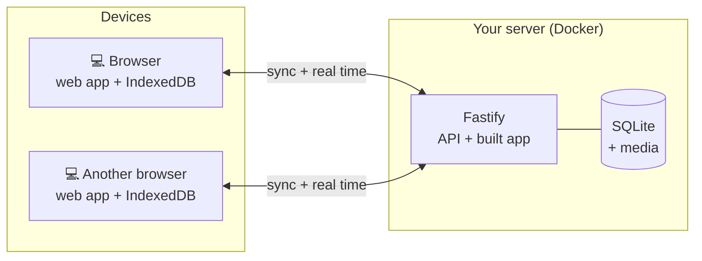

<div align="center">

English · [Français](README.fr.md)


# Halko

**Self-hosted workout tracker: plan your workouts, follow them live, see your progress.**

[](LICENSE)


[](https://github.com/ZSR17/halko/actions/workflows/ci.yml)
[](https://github.com/ZSR17/halko/releases)
[](https://github.com/ZSR17/halko/pkgs/container/halko)

</div>

Halko is a web app to plan your workouts, follow them live and see your progress. It runs on your own
server (a small computer is enough) and keeps a copy of the data in the browser: a network outage
interrupts nothing, and syncing resumes when the network is back. Native iPhone and Android apps are
planned; they will use the same sync API.

No account, no ads, no third-party service: your data stays at home.

## Features

**Library**
- 876 exercises in English and French, with pictures, instructions and the muscles worked on an anatomical figure.
- Main and secondary muscles picked on the body figure (the exercises working them so, the list narrowing
  as muscles are added), filters by muscle group and by the equipment at hand (or none), and search by name (in the language chosen, or in English).
- Your own exercises, with a photo, video or GIF (converted automatically to stay light), uploaded from a
  file or imported from a link and kept on your server.
- Your version of a library exercise (name, muscles, media), which you can revert at any time.

**Workouts**
- Workout builder: exercises reordered by drag and drop, supersets.
- Folders to sort workouts into, if wanted: drag a workout onto a folder; folders and workouts are
  ordered together.
- Eight exercise types: weight and reps, duration (plank), distance and duration, etc.
- Warm-up, normal, drop and to-failure sets; rest set per set. Warm-up weights and reps follow the
  working sets (from the empty bar, up to 85 %), unless typed in.
- Share a workout as a file, with or without the photos and videos of your own exercises, to import it
  on another Halko server.

**At the gym**
- Guided session: values prefilled with your last performance, rest timer (± 15 s), stopwatch.
- A beep, with adjustable volume, signals the end of the rest.
- Plate calculator: the plates to put on each side of the bar to reach a weight, with the ones you own, or
  the closest weights when it cannot be reached.
- 1RM calculator from a set, typed or taken from your history (Brzycki, Epley, McGlothin, Lombardi,
  Mayhew, O'Conner, Wathen), with the loads and the reps possible from 95 % to 50 %.

**Progress**
- Session history, personal records, estimated 1RM, volume.
- Progress charts per exercise and per workout.

**Your way**
- English or French, chosen on each device.
- Kilograms or pounds, kilometres or miles, chosen separately and whatever the language.
- Customisable colours, per device or shared.

**Several devices**
- In any recent browser, with a layout suited to narrow windows as well as large screens.
- Real-time sync between devices.
- Export and import of all your data as JSON.

## How it works



Each device works on its own local copy of the data. The server serves the app, keeps the reference copy
and passes the changes around; in a conflict, the latest change wins. The details are in
[docs/architecture.md](docs/architecture.md).

## Installation

You need Docker: on a Linux server or NAS, a Raspberry Pi, or Windows and Mac with Docker Desktop.
**HTTPS** access is recommended, not required: over plain HTTP, the password and the data go over the
network in clear text.

In a new folder, get [`compose.yaml`](compose.yaml), then:

```sh
# Choose the app password (asked twice, never shown): prints its hash
docker run --rm -it ghcr.io/zsr17/halko node --import tsx src/scripts/hash-password.ts
```

Put it in a `halko.env` file next to `compose.yaml`, between single quotes: `APP_PASSWORD_HASH='scrypt$…'`.

```sh
docker compose up -d
```

On first start, the server downloads the exercise library (a few minutes). Then open `http://address:3000`
in a browser, or better, put an HTTPS reverse proxy in front of port 3000.

Configuration, reverse proxy, backups and updates: [docs/deployment.md](docs/deployment.md).

## Development

Requirements: Node.js 22 or later. `ffmpeg` is optional (only for videos and GIFs).

```sh
npm install
npm run import:exercises                  # exercise library in server/data (~22 MB)
npm run hash-password -- --write .env     # dev password, written to server/.env
npm run dev                               # API on :3000 and app on http://localhost:5173
```

The dev data lives in `server/data`, separate from the production server's. To test on real data, replace
its content (`halko.db` and `media/`) with a copy of the production ones, with the dev server stopped,
and delete the `instance` row of its `meta` table: the dev browser's app then sees that the database
changed and starts over instead of mixing the two.

| Command | Purpose |
| --- | --- |
| `npm run dev` | Server and app in development, reloaded on every change |
| `npm test` | Server and app tests (Vitest) |
| `npm run typecheck` | TypeScript check of the three packages |
| `npm run build` | Build of the web app into `client/dist` |
| `npm run seed:history` | Push, Pull and Legs workouts with 18 months of history in `server/data`, to try the history, records and charts |
| `npm run export:library -- --out <folder>` | The exercise library as a new server imports it (`exercises.json` and `images/`), for an app that embeds it |
| `npm run db:generate` | New migration after a change to `server/src/db/schema.ts` |
| `npx knip` | Detection of unused code and dependencies |
| `npm run release -- minor` | Publishes a version (`patch` for fixes only, `major` when updating needs a manual step) |

```
halko/
├── shared/   common vocabulary: exercise types, muscles, API schemas (zod), app texts (i18n)
├── server/   Fastify API, SQLite (Drizzle), media, exercise import
│   └── drizzle/   SQL migrations, applied on start
├── client/   React + Vite web app, local IndexedDB data (Dexie)
├── docker/   start of the Docker image (data folder owner)
├── scripts/  publishing a version
└── docs/     detailed documentation
```

## Documentation

- [Architecture](docs/architecture.md): local data, sync, media.
- [Deployment](docs/deployment.md): Docker, configuration, HTTPS, backups, updates.
- [API](docs/api.md): every server route.
- [Changelog](CHANGELOG.md): what each version brings.
- [Adding a language](docs/i18n.md): app texts and exercise library.

## Credits

- Exercises and pictures: [free-exercise-db](https://github.com/yuhonas/free-exercise-db) (public domain),
  translated into French for Halko.
- Anatomical figure: [react-native-body-highlighter](https://github.com/HichamELBSI/react-native-body-highlighter)
  (MIT, see `client/src/assets/body-paths.LICENSE`).

## License

[Apache 2.0](LICENSE): see also [NOTICE](NOTICE).
