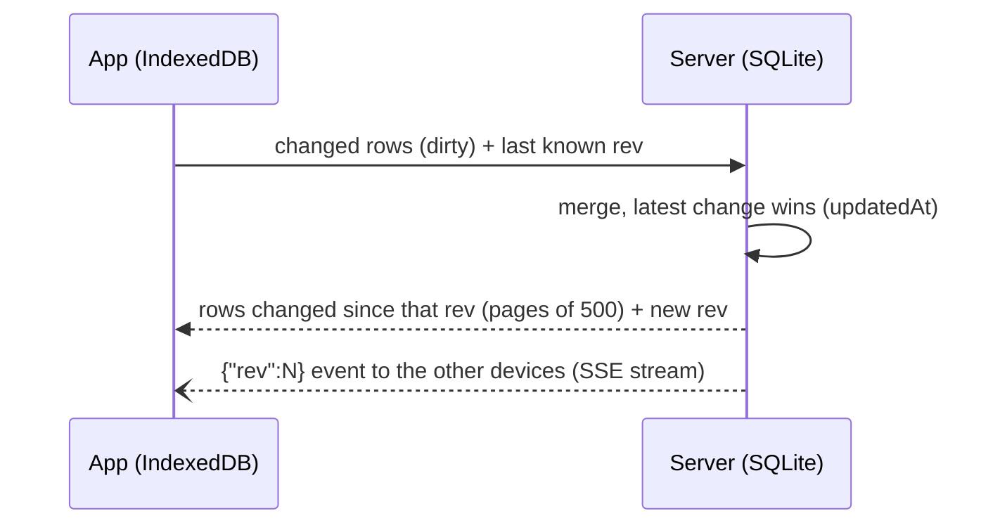

English · [Français](fr/architecture.md)

# Architecture

Halko is an npm monorepo of three TypeScript packages:

| Package | Content |
| --- | --- |
| `shared/` | Common vocabulary: sports, exercise types, muscles, zod schemas of the API and the sync, app texts in every language. |
| `server/` | Fastify API, SQLite database (better-sqlite3 + Drizzle), media (sharp, ffmpeg). |
| `client/` | React + Vite web app, local IndexedDB database (Dexie). |

In production, a single Docker image serves the API and the built app.

## Local data first

The app **only** reads and writes its local IndexedDB database. Nothing waits for the network: once the
page is loaded, creating a workout, doing it and looking at the history keep working if the connection
drops, and the changes go out when the network is back.

- Storage is requested as persistent (`navigator.storage.persist()`), so the browser does not clear it
  when space runs low.
- The session in progress is a state local to the device. Timers are timestamps: they survive the app
  going to sleep.

## Sync

A single entry point, `POST /api/v1/sync`, which sends the local changes and receives those of the other
devices.

- **Global revision.** Each write on the server gets an increasing `rev` number. A device asks for
  everything that changed since the last `rev` it saw; the response is paginated (`hasMore`,
  `remaining`, to show the progress of the first download).
- **Conflicts.** Per row, the latest change (`updatedAt`) wins.
- **Deletions.** Rows are never erased but marked `deleted` (tombstones), so that the deletion reaches
  every device.
- **Real time.** Open apps listen to `GET /api/v1/events` (Server-Sent Events, read with `fetch` to be able
  to send the token) and sync as soon as another device changed something.
- **Replaced database.** Each database has an id (`instance`), returned on every sync. If the server gives
  another one than at the last sync (reinstall, copy of another database), the app forgets its local data
  and downloads everything, instead of mixing two databases whose rows do not share ids.
- **No network.** A network error or a 502 to 504 response from the reverse proxy counts as "offline": the
  changes wait and go out when the network is back.

### Exercises

The library (876 exercises from free-exercise-db, in English and French) is shared. When you change a
library exercise, your version is stored apart (`exercise_overrides`) and merged on the fly: the library
can be updated without overwriting your changes, and "Restore the original" simply deletes your version.
Your own exercises have `source: 'custom'`. A library exercise has the same id on every server,
`lib-<sourceRef>` (`server/src/import/library-ids.ts`); the old random ids are kept on deleted rows that
point at the new one (`replaced_by`), for the devices that still send them.

Its texts are in `server/src/import/library/`: `en.json` (the original text, the reference), one file per
other language (`fr.json`, complete or not) and `fixes.json` (muscle and type fixes, whatever the
language). They are applied on every start, idempotently: `name` and `instructions` stay in English, the
other languages go into `translations`. The app shows each exercise in the language chosen on the device,
else in English, and search also finds the English name.

## Languages and units

The app texts are in `shared/src/i18n/messages/<language>.json`, English being the reference: a text
missing in a language shows in English. The language, the weight unit (kg or lb) and the distance unit
(km or mi) are chosen on each device, at first launch then in the Settings; they are not synced. The data
stays in SI units, only display and input convert. See [i18n.md](i18n.md) to add a language.

## Data model

| Table | Purpose |
| --- | --- |
| `users`, `devices` | User and connected devices (one long-lived token per device, revocable). |
| `exercises`, `exercise_overrides` | Library, custom exercises, personal versions of library exercises. |
| `folders` | Folders workouts can be sorted into (one level, optional). |
| `workouts`, `workout_items` | Planned workouts and their exercises (planned sets, rest, supersets, time to change sides). |
| `sessions`, `set_logs` | Workouts done and sets performed. |
| `media` | Uploaded files (identified by their sha256 hash). |
| `user_settings` | Settings shared between devices (colours). |

Choices made to evolve without a rewrite: a `user_id` on every table, a `sport` field (running and
cycling are planned), SI units everywhere (grams, metres, seconds) and dates in UTC milliseconds. The SQL
migrations (`server/drizzle/`) are applied on start.

## Media

- Files are named by their sha256 hash: the same file is stored only once, and the
  `GET /media/<sha256>.webp|mp4` URLs are cached forever.
- Photo → 480 px WebP. Video or animated GIF → 480p H.264 MP4, 15 s at most, without sound, plus a
  preview picture (ffmpeg).
- Every day, files no exercise uses are deleted, after a 7-day grace period.

## Authentication

A single user, protected by a password of which only the scrypt hash is stored (`APP_PASSWORD_HASH`). Each
login creates a device with its own token, sent as `Authorization: Bearer`. A device can be logged out
from the Settings of another one. Login is limited to 10 attempts per minute.
