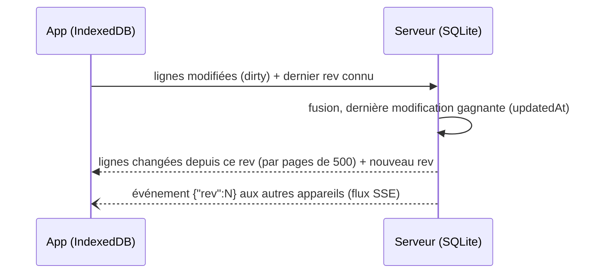

[English](../architecture.md) · Français

# Architecture

Halko est un monorepo npm en trois paquets TypeScript :

| Paquet | Contenu |
| --- | --- |
| `shared/` | Vocabulaire commun : sports, types d'exercice, muscles, schémas zod de l'API et de la synchro, textes de l'app dans chaque langue. |
| `server/` | API Fastify, base SQLite (better-sqlite3 + Drizzle), médias (sharp, ffmpeg). |
| `client/` | App web React + Vite, base locale IndexedDB (Dexie). |

En production, une seule image Docker sert l'API et l'application compilée.

## Données locales d'abord

L'application ne lit et n'écrit **que** dans sa base locale IndexedDB. Rien n'attend le réseau : une fois
la page chargée, créer une séance, la faire, consulter l'historique continue de fonctionner si la connexion
tombe, et les modifications partent au retour du réseau.

- Le stockage est demandé comme persistant (`navigator.storage.persist()`), pour que le navigateur ne
  l'efface pas quand l'espace manque.
- La séance en cours est un état local à l'appareil. Les minuteurs sont des horodatages : ils survivent à
  la mise en veille de l'app.

## Synchronisation

Un seul point d'entrée, `POST /api/v1/sync`, qui envoie les modifications locales et reçoit celles des
autres appareils.

- **Révision globale.** Chaque écriture côté serveur reçoit un numéro `rev` croissant. Un appareil demande
  tout ce qui a changé depuis le dernier `rev` qu'il a vu ; la réponse est paginée (`hasMore`,
  `remaining`, pour afficher la progression du premier téléchargement).
- **Conflits.** Par ligne, la modification la plus récente (`updatedAt`) gagne.
- **Suppressions.** Les lignes ne sont jamais effacées mais marquées `deleted` (tombstones), pour que la
  suppression se propage à tous les appareils.
- **Temps réel.** Les apps ouvertes écoutent `GET /api/v1/events` (Server-Sent Events, lu avec `fetch`
  pour pouvoir envoyer le jeton) et se synchronisent dès qu'un autre appareil a modifié quelque chose.
- **Base remplacée.** Chaque base a un identifiant (`instance`), renvoyé à chaque synchro. Si le serveur
  en donne un autre que celui de la dernière synchro (réinstallation, copie d'une autre base), l'app
  oublie ses données locales et télécharge tout, au lieu de mélanger deux bases dont les lignes n'ont pas
  les mêmes identifiants.
- **Réseau absent.** Une erreur réseau ou une réponse 502 à 504 du reverse proxy est traitée comme
  « hors ligne » : les modifications restent en attente et repartent au retour du réseau.

### Exercices

La bibliothèque (876 exercices de free-exercise-db, en anglais et en français) est commune. Quand tu modifies un
exercice de la bibliothèque, ta version est stockée à part (`exercise_overrides`) et fusionnée à la volée :
la bibliothèque peut être mise à jour sans écraser tes changements, et « Rétablir l'original » supprime
simplement ta version. Tes propres exercices ont `source: 'custom'`.

Ses textes sont dans `server/src/import/library/` : `en.json` (le texte d'origine, la référence), un
fichier par autre langue (`fr.json`, complet ou non) et `fixes.json` (corrections de muscles et de types,
quelle que soit la langue). Ils sont appliqués à chaque démarrage, de façon idempotente : `name` et
`instructions` restent en anglais, les autres langues vont dans `translations`. L'app affiche chaque
exercice dans la langue choisie sur l'appareil, sinon en anglais, et la recherche trouve aussi le nom
anglais.

## Langues et unités

Les textes de l'app sont dans `shared/src/i18n/messages/<langue>.json`, l'anglais servant de référence :
un texte absent d'une langue s'affiche en anglais. La langue, l'unité de poids (kg ou lb) et l'unité de
distance (km ou mi) se choisissent sur chaque appareil, au premier lancement puis dans les Réglages ; elles
ne sont pas synchronisées. Les données restent en unités SI, seuls l'affichage et la saisie convertissent.
Voir [i18n.md](i18n.md) pour ajouter une langue.

## Modèle de données

| Table | Rôle |
| --- | --- |
| `users`, `devices` | Utilisateur et appareils connectés (un jeton longue durée par appareil, révocable). |
| `exercises`, `exercise_overrides` | Bibliothèque, exercices perso, versions perso des exercices de la bibliothèque. |
| `folders` | Dossiers où ranger les séances (un seul niveau, facultatifs). |
| `workouts`, `workout_items` | Séances planifiées et leurs exercices (séries prévues, repos, supersets, temps pour changer de côté). |
| `sessions`, `set_logs` | Séances réalisées et séries effectuées. |
| `media` | Fichiers envoyés (identifiés par leur empreinte sha256). |
| `user_settings` | Réglages partagés entre appareils (couleurs). |

Choix faits pour pouvoir évoluer sans refonte : un `user_id` sur toutes les tables, un champ `sport` (la
course et le vélo sont prévus), des unités SI partout (grammes, mètres, secondes) et des dates en
millisecondes UTC. Les migrations SQL (`server/drizzle/`) s'appliquent au démarrage.

## Médias

- Les fichiers sont nommés par leur empreinte sha256 : un même fichier n'est stocké qu'une fois, et les URL
  `GET /media/<sha256>.webp|mp4` sont mises en cache définitivement.
- Photo → WebP 480 px. Vidéo ou GIF animé → MP4 H.264 480p, 15 s maximum, sans son, plus une image
  d'aperçu (ffmpeg).
- Chaque jour, les fichiers qu'aucun exercice n'utilise sont supprimés, après 7 jours de grâce.

## Authentification

Un seul utilisateur, protégé par un mot de passe dont seule l'empreinte scrypt est stockée
(`APP_PASSWORD_HASH`). Chaque connexion crée un appareil avec son propre jeton, envoyé en
`Authorization: Bearer`. Un appareil peut être déconnecté depuis les Réglages d'un autre. La connexion est
limitée à 10 essais par minute.
